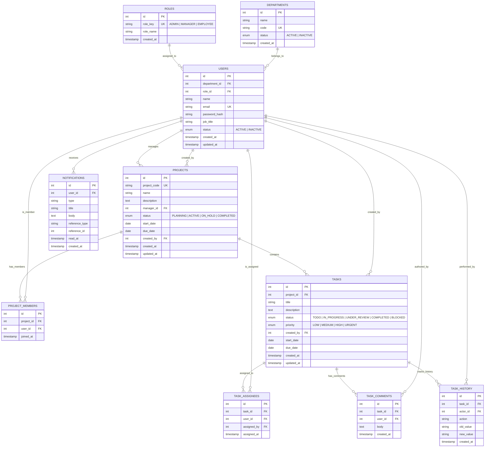

# TeamSync — Database Schema & Entity Relationship (ER) Documentation

## MySQL 8.0 Relational Architecture

The database is built on MySQL 8.0 using the **InnoDB** storage engine to support ACID transactions, strict foreign keys, and unique integrity constraints.

### Entity Relationship Diagram

### Key Constraints and Indexes

1. **Unique Constraints:**
   - `users.email`
   - `departments.code`
   - `projects.project_code`
   - `project_members(project_id, user_id)`
   - `task_assignees(task_id, user_id)`

2. **Performance Indexes:**
   - `projects(manager_id, status)`
   - `tasks(project_id, status)`
   - `tasks(due_date)`
   - `task_assignees(user_id, task_id)`
   - `notifications(user_id, read_at, created_at)`
   - `task_comments(task_id, created_at)`
   - `task_history(task_id, created_at)`
